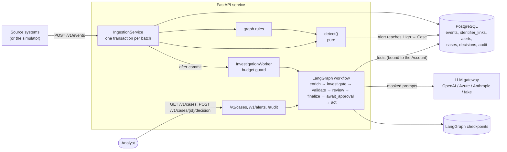
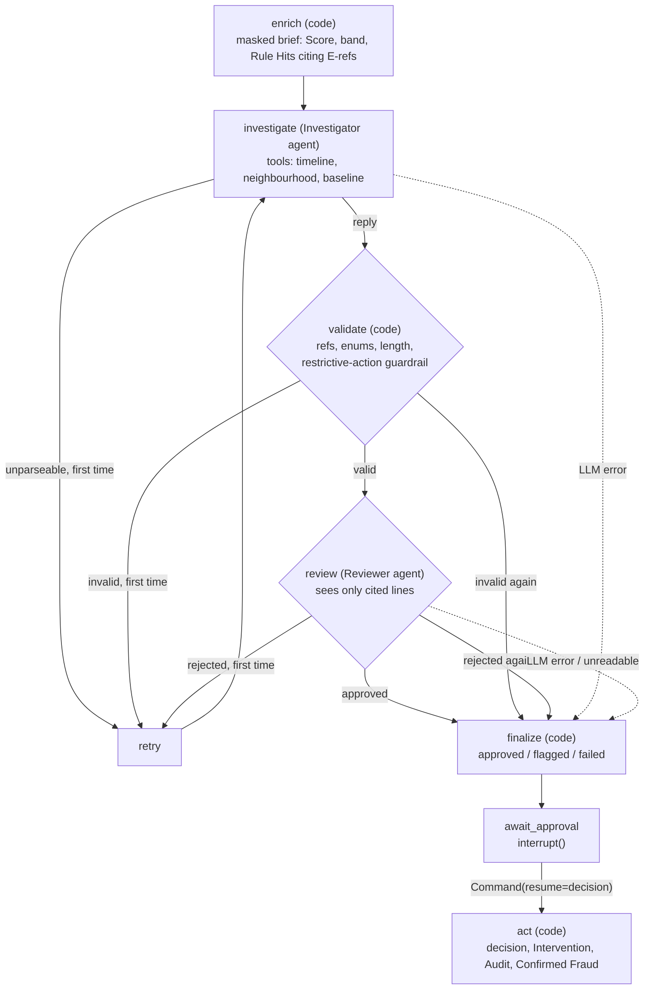

# Architecture

How the service is built and how its parts fit. Terms are defined in [GLOSSARY.md](../GLOSSARY.md); each decision has
an ADR in [adr/](adr/).

## In one picture

Cheap, deterministic rules score every event as it arrives. The Link Graph adds what one Account's history cannot
show: links to other Accounts and to known fraud. Only an Account whose Alert reaches High gets a Case. Two AI agents
investigate the Case on masked data, and the Case then waits for a named analyst to decide. Every step is recorded.



## Modules

```
src/fraud_audit_assist/
├─ domain/        events, rules (6 kinds), alerts, cases, Domain Packs, Scenarios, durations
├─ detection/     detect() and its matchers, Risk Episodes, offline replay      ← pure, no I/O
├─ graph/         identifier links, LinkGraphReader + in-memory graph, graph rules, Neighbourhood
├─ agents/        Evidence Ledger, tools, Investigator/Reviewer, validation, LangGraph workflow, prompts, LLM gateway
├─ persistence/   SQLAlchemy tables, Database (transactions, locks, retries), repositories
├─ services/      ingestion, Case queue, Investigation runner/worker, decisions and Act
├─ api/           FastAPI app, routes, schemas, API-key roles
├─ simulator/     Persona Dataset generator, dry runs, API client
├─ observability/ structlog, Prometheus metrics, OpenTelemetry
├─ container.py   composition root: builds every service from Settings
├─ config.py      pydantic-settings, validated at startup
└─ cli.py         `faa` command
```

Dependencies point inwards: `detection`, `graph` and `agents` depend on `domain` and on narrow protocols
(`LinkGraphReader`, `InvestigationSource`, `ActHandler`), never on the database or the web layer. Services and the
container wire the real implementations in; tests and dry runs wire in-memory ones. That is how one detection engine
and one workflow serve live traffic, dry runs and (later) offline evaluation.

## Ingestion and detection

`POST /v1/events` takes a batch (up to 1,000 events). `IngestionService.ingest` runs it as one transaction, replayed
whole on a PostgreSQL deadlock or serialisation failure:

```mermaid
sequenceDiagram
    participant C as Client
    participant I as IngestionService
    participant D as Database
    participant G as Graph rules
    participant X as detect()
    participant Q as CaseQueue

    C->>I: POST /v1/events
    I->>I: validate event types against the pack
    I->>D: BEGIN; lock batch Accounts (sorted)
    I->>D: append events (ON CONFLICT DO NOTHING)
    I->>D: upsert identifier links (earliest wins)
    I->>D: find Neighbours within the widest ring's reach; lock them (sorted)
    loop each batch Account, then each Neighbour
        I->>D: timeline + stored Alerts
        I->>G: graph hits for the Account
        I->>X: detect(timeline, rules, stored, graph hits)
        I->>D: append new Rule Hits; open a Case when an Alert first reaches High
    end
    I->>D: COMMIT
    I->>Q: queue opened Cases
    I-->>C: ingested / duplicates / re-scored / opened
```

Why this order:
- **Locks in sorted order** serialise batches for the same Account without deadlocking on the batch's own Accounts.
- **Links in the same transaction** as the events: no dual write, and a rolled-back batch leaves no stray link (ADR-0015).
- **Neighbours re-scored in the request**: the first member of a ring is lifted by the third member's event.
- **Cases queued after commit**: a rolled-back batch never starts an Investigation (ADR-0004).

`detect()` is pure (ADR-0001): six rule kinds produce candidate hits, Risk Episodes place them (ADR-0013), each Rule
counts once per episode, and stored Alerts are only extended. Time is always event time, never the wall clock.

## The Investigation



- The worker admits a Case past the budget guard, the runner runs its thread until `interrupt()`, then stores the
  masked Finding, flags, Pseudonym map, refs, usage and Prompt Versions on the Case, writes the InvestigationCompleted
  and ReviewCompleted Audit Entries and moves it to AwaitingApproval.
- Every step is checkpointed (the Evidence Ledger is part of the state), so a crash mid-Investigation resumes from
  the last finished step, and a Case awaiting approval survives restarts (ADR-0005).
- `GET /v1/cases/{id}` unmasks the Finding for the analyst and resolves each cited ref to event ids.
- `POST /v1/cases/{id}/decision` claims the Case, resumes the thread, and Act records everything in one transaction
  (ADR-0019). A ConfirmedFraud outcome marks the Account as Confirmed Fraud and re-scores its Neighbours.

### Guardrails

| Risk | Control |
|---|---|
| Personal data in prompts | Per-Investigation Pseudonyms by value; attributes masked by default; short values withheld (ADR-0008) |
| Prompt injection through source data | Free text never reaches a model; shown values must be single short tokens; prompts treat evidence as data |
| Hallucinated evidence | Every cited ref checked in code before review; the Reviewer sees exactly the cited lines (ADR-0006) |
| Harmful recommendation | A restrictive action needs a fraud verdict, checked in code |
| Model reads another customer | Tools are bound to the Case's Account and take no account argument (ADR-0007) |
| Runaway cost | Daily Investigation limit, bounded tool loop, one retry, token/cost logged per call |
| Provider outage | Retries on transient errors, optional fallback model, then InvestigationFailed: the Case still reaches a person |
| AI acting alone | Agents recommend; only `act`, after a named analyst's decision, records anything |

## Data model

| Table | Holds |
|---|---|
| `events` | Append-only events, primary key `event_id`, JSON `attributes`, index `(account_id, occurred_at)` |
| `identifier_links` | The Link Graph: `(account_id, kind, value)` → `first_seen`, `first_event_id`, `customer_id`; index `(kind, value)` |
| `alerts`, `rule_hits` | One Alert per Risk Episode; append-only hits with evidence ids, trigger time, explanation, Rules Version |
| `cases` | Status, priority, flags, masked Finding, Pseudonym map, Evidence Refs, usage, Prompt Versions, trace id |
| `analyst_decisions` | One per Case (primary key `case_id`) |
| `interventions` | Actions for the source system to enforce, with an end date where the action has a duration |
| `confirmed_frauds` | One per Account, with source (Seed or Analyst) |
| `audit_entries` | Append-only trail: actor, model, Prompt Version, Rules Version, evidence, tokens, cost |
| LangGraph tables | Workflow checkpoints, created by the checkpointer at startup |

## Configuration

All settings are environment variables with the `FAA_` prefix (nested with `__`), validated at startup; see
[`.env.example`](../.env.example). Production refuses missing API keys, the fake LLM and SQLite.

## Known limits

- **One instance.** The in-process queue and one-at-a-time worker assume a single API process (ADR-0004).
- **Full timelines.** Each re-score loads the Account's whole history. Fine for portal-scale histories; a long-lived
  high-volume Account would want a bounded look-back plus a stored set of seen values for First Sightings.
- **One pack per instance** (ADR-0017).
- **Rules are still rules.** Journeys that avoid every pattern (credential stuffing without a reset, MFA removal) are
  known misses, kept in the golden dataset to measure them.
- **No analyst UI.** The API (with its OpenAPI docs at `/docs`) is the analyst surface for now.
